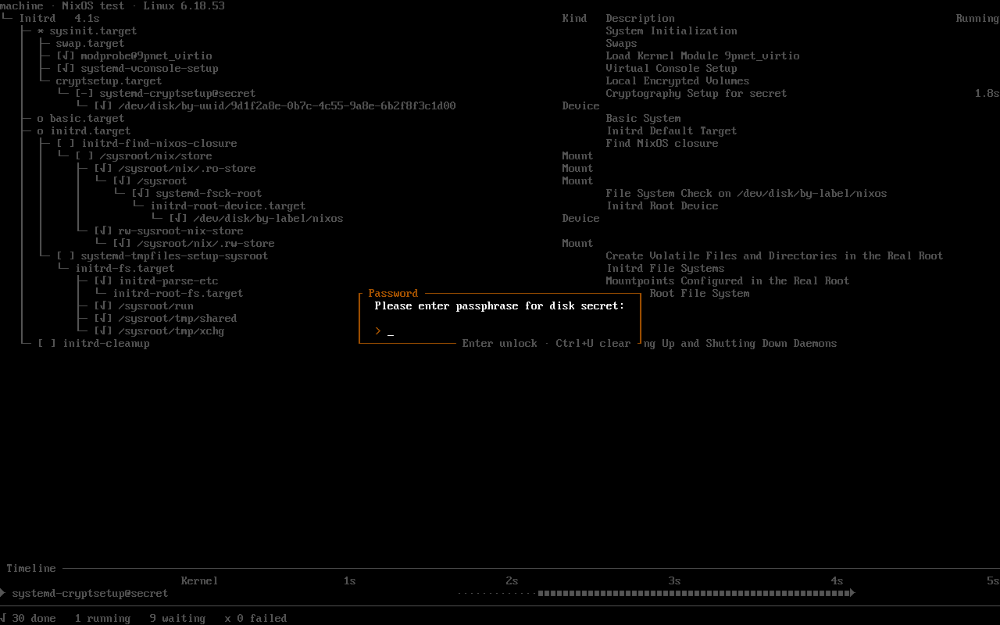

# bootvine

A live tree of systemd jobs on the boot console, in the spirit of
nix-output-monitor. It replaces the scrolling kernel and systemd lines with the
units still pending and, in the room the tree leaves, a timeline of the slowest
ones that ran.


It needs systemd ≥ 246 as PID 1, libdbus and a virtual terminal (it draws on
tty12). With a systemd initrd it starts about a second after the kernel and
follows the boot through the switch to the real root; without one it starts in
stage 2. While it runs it quiets the kernel console and systemd's status
output, and restores both when it hands the console back. Kernel messages from
before it starts still reach the screen; boot with `quiet`, or set
`boot.consoleLogLevel = 3` on NixOS, to keep those to errors.

It also follows shutdowns and reboots: the units being stopped, nested under
the units that have to stop first, until systemd hands over to
`systemd-shutdown`.


Passphrase prompts, such as a LUKS unlock in the initrd, are answered in place
over the tree.



## Try

```sh
cargo run --example boot
cargo run --example shutdown
cargo run --example luks
```

play a scripted boot, poweroff or boot from an encrypted root without systemd;
`q` quits. The encrypted root unlocks with the passphrase `demo`; `Esc` quits
while it asks. `nix run .#vm` boots a demo
VM in a window.

## Install

### NixOS

1. Add the flake to your system flake's inputs and pass its module in:

   ```nix
   {
     inputs.bootvine = {
       url = "git+https://codeberg.org/wvhulle/bootvine";
       inputs.nixpkgs.follows = "nixpkgs";
     };

     outputs = { nixpkgs, bootvine, ... }: {
       nixosConfigurations.my-host = nixpkgs.lib.nixosSystem {
         modules = [
           bootvine.nixosModules.default
           ./configuration.nix
         ];
       };
     };
   }
   ```

2. Enable it in `configuration.nix`:

   ```nix
   {
     services.bootvine.enable = true;
   }
   ```

3. Optionally, follow the boot from the initrd and keep early kernel messages
   to errors:

   ```nix
   {
     boot.initrd.systemd.enable = true;
     boot.consoleLogLevel = 3;
   }
   ```

4. Rebuild and reboot:

   ```sh
   sudo nixos-rebuild switch --flake .#my-host
   ```

### Ubuntu

1. Install the build dependencies and Rust. The repository pins a nightly
   toolchain in `rust-toolchain.toml`, which rustup fetches on the first
   build:

   ```sh
   sudo apt install build-essential pkg-config libdbus-1-dev git curl
   curl --proto '=https' --tlsv1.2 -sSf https://sh.rustup.rs | sh
   ```

2. Build:

   ```sh
   git clone https://codeberg.org/wvhulle/bootvine.git
   cd bootvine
   cargo build --release
   ```

3. Install the binary and the systemd units, and enable them:

   ```sh
   sudo install -Dm755 target/release/bootvine /usr/bin/bootvine
   sudo install -Dm644 -t /usr/lib/systemd/system \
     packaging/systemd/bootvine.service packaging/systemd/bootvine-shutdown.service
   sudo systemctl enable bootvine.service bootvine-shutdown.service
   ```

   This is enough for bootvine to show stage 2 and shutdown.

4. Optionally, follow the boot from the initrd. This needs a dracut initramfs
   with systemd in it; initramfs-tools has no systemd, so on releases that use
   it bootvine starts in stage 2 only.

   ```sh
   sudo install -Dm755 packaging/dracut/90bootvine/module-setup.sh \
     /usr/lib/dracut/modules.d/90bootvine/module-setup.sh
   echo 'add_dracutmodules+=" bootvine "' | sudo tee /etc/dracut.conf.d/bootvine.conf
   sudo dracut --force
   ```

5. Reboot.

### Other distributions

Install the binary and units as in the Ubuntu steps. For the initrd, use the
dracut module as above, or on mkinitcpio install
`packaging/mkinitcpio/install/sd-bootvine` to `/usr/lib/initcpio/install/`, add
`sd-bootvine` after `systemd` in `HOOKS` in `/etc/mkinitcpio.conf`, and run
`sudo mkinitcpio -P`.

## Configure

`/etc/bootvine.toml`, or `services.bootvine.palette` and
`services.bootvine.timing` on NixOS. Every key is optional; these are the
defaults:

```toml
[palette]
text = "white"
muted = "dark-gray"
waiting = "gray"
running = "yellow"
done = "green"
failed = "light-red"
target = "cyan"

[timing]
keep_finished_units_for = "2s"
hide_runs_shorter_than = "1s"
keep_final_frame_for = "1s"
```

Palette values are the 16 console colour names. To change how those look, set
the console palette: `console.colors` on NixOS, or the `vt.default_red`, `_grn`
and `_blu` kernel parameters elsewhere.

`keep_finished_units_for` is how long a finished unit stays in the tree, faded,
before it leaves. Runs shorter than `hide_runs_shorter_than` get no timer and no
timeline bar. `keep_final_frame_for` is how long the last frame stays before the
console is handed back; `--hold` overrides it.

The initrd hooks copy the file into the initramfs, so rebuild it after editing.
