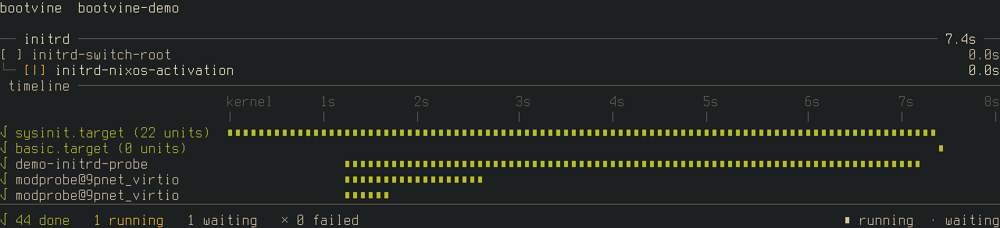
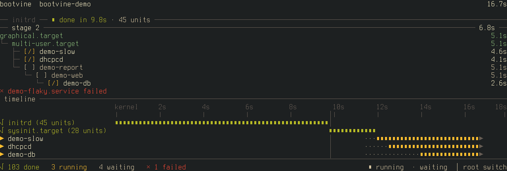

# bootvine

A live tree of systemd jobs on the boot console, in the spirit of
nix-output-monitor. It replaces the scrolling kernel and systemd lines with the
units still pending and a timeline of the ones that ran.




It needs systemd ≥ 246 as PID 1, libdbus and a virtual terminal (it draws on
tty12). With a systemd initrd it starts about a second after the kernel and
follows the boot through the switch to the real root; without one it starts in
stage 2. While it runs it quiets the kernel console and systemd's status
output, and restores both when it hands the console back.

## Try

```sh
cargo run --example demo
```

plays a scripted boot without systemd; `q` quits. `nix run .#vm` boots a demo
VM in a window.

## Install

On NixOS, import `nixosModules.default` from the flake and set
`services.bootvine.enable = true`. With `boot.initrd.systemd.enable` the unit
goes into the initrd as well.

Elsewhere, install the binary to `/usr/bin` and the package's `lib/` under
`/usr/lib`, then `systemctl enable bootvine.service`. To start it in the
initrd, add `bootvine` to `add_dracutmodules` (dracut) or `sd-bootvine` after
`systemd` in `HOOKS` (mkinitcpio), and rebuild the initramfs.

## Configure

`/etc/bootvine.toml`, or `services.bootvine.palette` on NixOS. Every key is
optional; these are the defaults:

```toml
[palette]
text = "white"
muted = "dark-gray"
waiting = "gray"
running = "yellow"
done = "green"
failed = "light-red"
target = "cyan"
```

Values are the 16 console colour names. To change how those look, set the
console palette: `console.colors` on NixOS, or the `vt.default_red`, `_grn` and
`_blu` kernel parameters elsewhere. The initrd hooks copy the file into the
initramfs, so rebuild it after editing.
