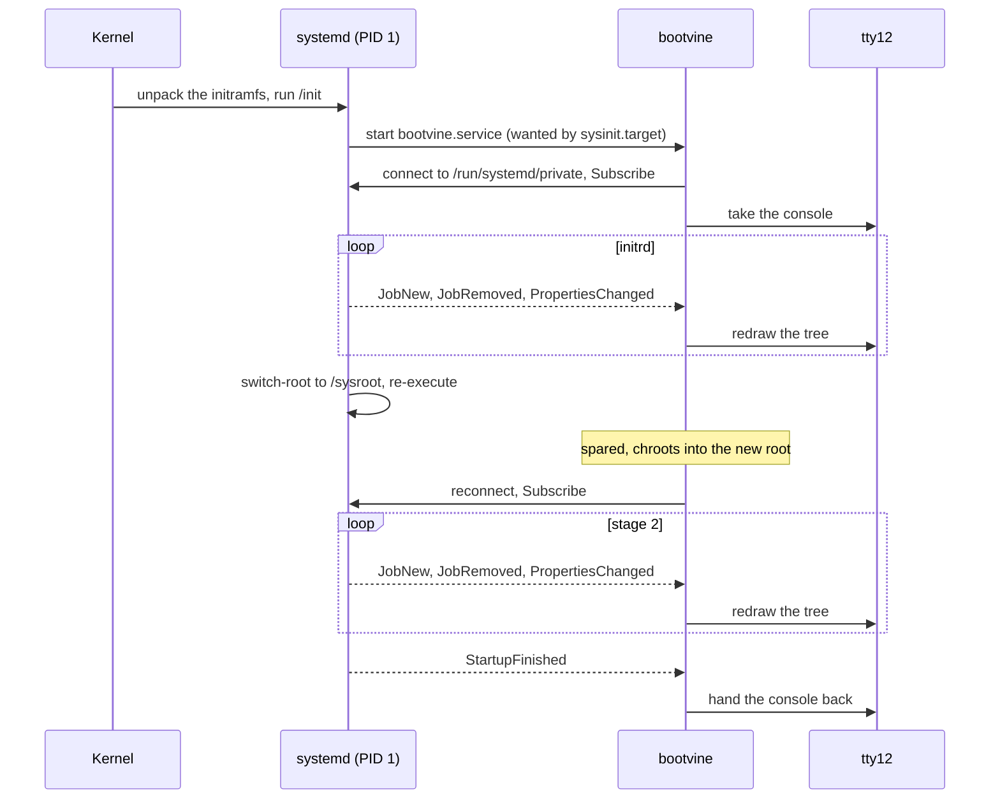
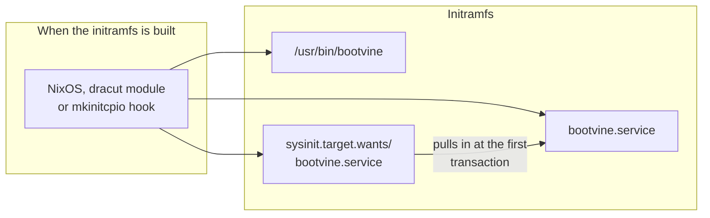
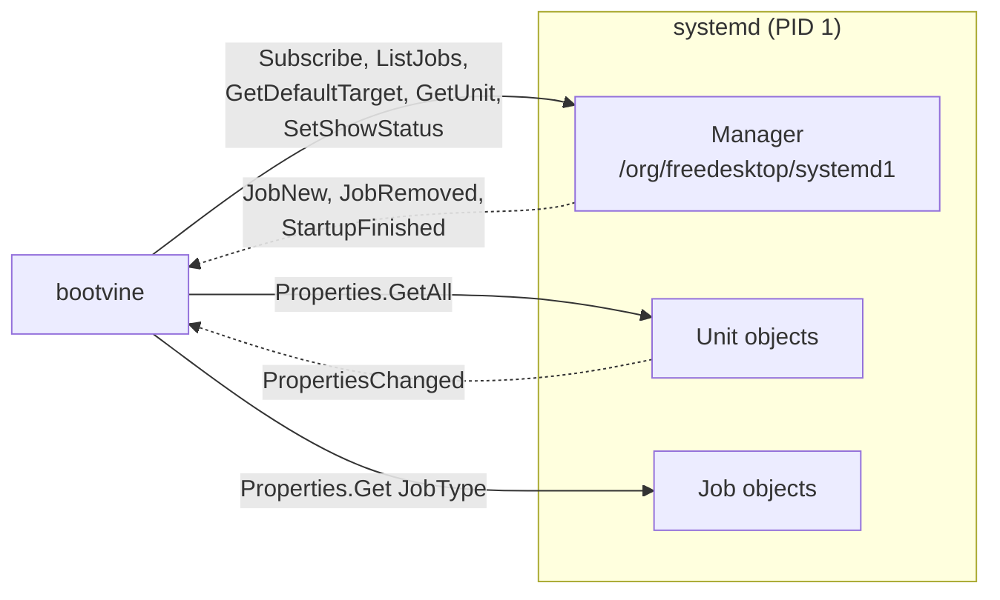
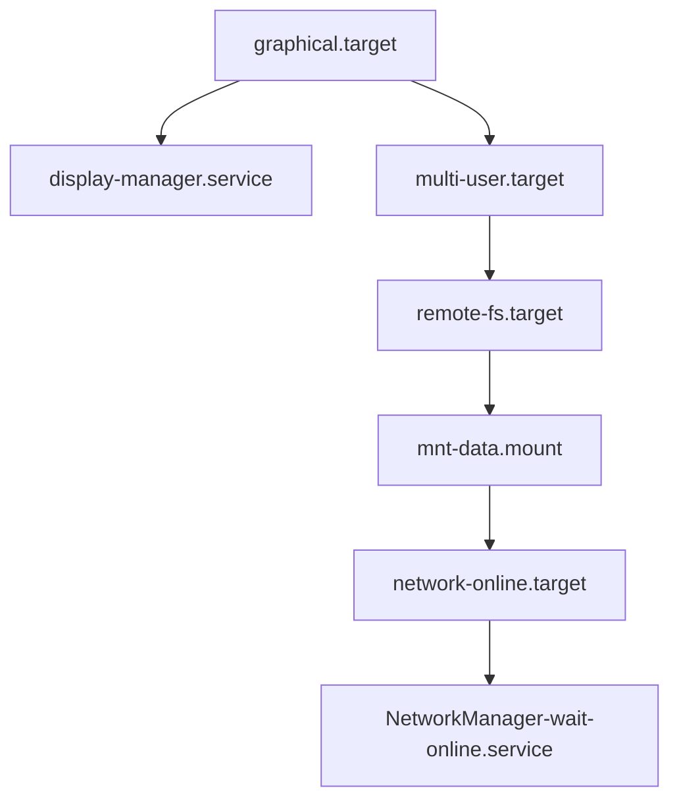
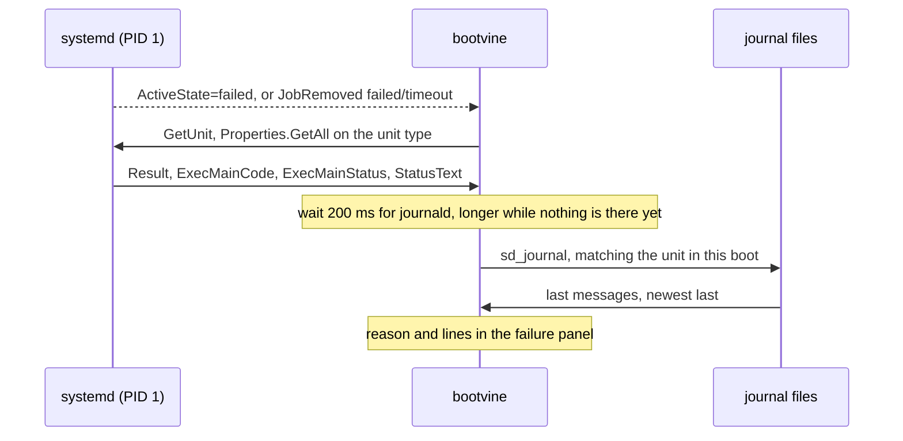
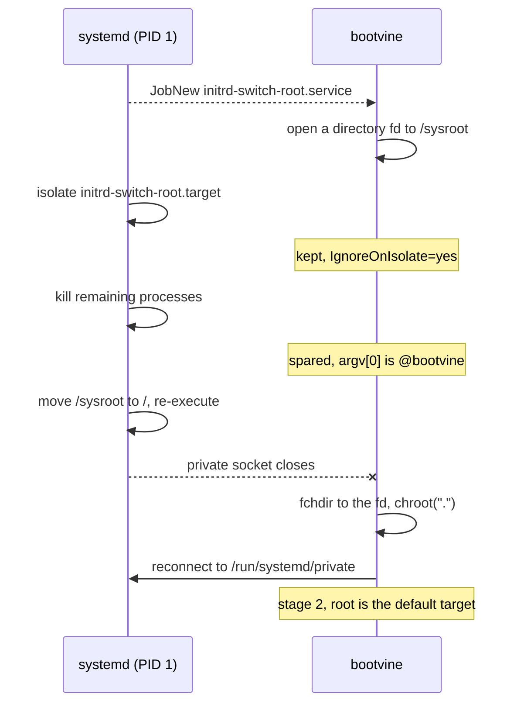

# Architecture

How bootvine follows a boot and a shutdown, and what it changes on the console
while it does. None of this is needed to install or configure it.

## Requirements

- **systemd ≥ 246 as PID 1.** bootvine reads the jobs and units from the
  service manager over D-Bus.
- **[libdbus](https://www.freedesktop.org/wiki/Software/dbus/).** It talks to
  PID 1 over systemd's private socket, which
  [zbus](https://github.com/dbus2/zbus) cannot use; see
  [systemd's private socket](#systemds-private-socket).
- **libsystemd.** It reads the last journal lines of a failed unit; see
  [failures](#failures).
- **A virtual terminal.** It draws on `tty12` and switches the console to it.

## Overview

## Starting in the initrd

The initrd is a small root file system that the kernel unpacks into memory and
runs before the real root is mounted. When it runs systemd, its `/init` is
systemd as PID 1, with the same units, targets and D-Bus API as on the real
root. bootvine hooks into that systemd rather than into the kernel.

1. **The image.** The initramfs generator copies the binary,
   `bootvine.service` and `/etc/bootvine.toml` into the image and enables the
   unit there, which links it into `sysinit.target.wants`.
2. **The first transaction.** systemd in the initrd starts `initrd.target`,
   which pulls in `sysinit.target` and with it `bootvine.service`.
3. **No waiting.** `DefaultDependencies=no` drops the implicit
   `After=sysinit.target basic.target`, so bootvine is not ordered after
   anything and starts in parallel with udev and the first mounts, about a
   second after the kernel.
4. **Knowing where it is.** `/etc/initrd-release` exists only in an initrd, so
   its presence tells bootvine it is in the initrd stage.

Without a systemd initrd, the same unit is enabled in the real root and starts
in stage 2 instead.

## What systemd exposes

PID 1 publishes its state on D-Bus under `org.freedesktop.systemd1`. In the
initrd there is no D-Bus daemon yet, so bootvine connects straight to PID 1 on
the private socket `/run/systemd/private`, which systemd listens on from the
moment it starts. Where that socket is not available, it falls back to the
system bus.

On connecting, bootvine:

1. calls `Subscribe`, without which PID 1 sends no signals;
2. calls `ListJobs` for the jobs already queued, since some were queued before
   it started;
3. calls `GetDefaultTarget` for the root of the tree, such as
   `initrd.target` in the initrd and `graphical.target` in stage 2;
4. reads `FinishTimestampMonotonic`, which stays 0 until the boot is finished.

From then on it follows the signals:

| Signal | Carries | Used for |
| --- | --- | --- |
| `JobNew` | job id, job path, unit name | a row in the tree |
| `JobRemoved` | job id, unit name, result | the row finishes as done, failed or skipped |
| `PropertiesChanged` on a unit | `ActiveState` and its timestamps | running since, and the timeline |
| `StartupFinished` | | the boot reached its default target |

For each unit it meets, `GetUnit` and `Properties.GetAll` give its
`Description`, its `After=` and `Before=` orderings and its timeouts.

### From orderings to a tree

A unit waits on the units in its `After=` that still have a pending job; when
stopping, on the units in its `Before=`. bootvine nests each unit under the one
waiting on it, starting from the default target.

Here `graphical.target` is `After=multi-user.target`, `remote-fs.target` is
`After=` the network mount, the mount is `After=network-online.target`, and so
on down to the unit that is actually running. A target is ordered after the
units it wants, so targets fill the upper levels.

### Timestamps

systemd's `…TimestampMonotonic` properties count microseconds of
`CLOCK_MONOTONIC`, which starts with the kernel. bootvine reads the same
clock, so the times it shows are measured from the kernel start, even for
units that ran before bootvine did.

### Failures

`JobRemoved` says how a job ended: `failed`, `timeout` or `dependency`. Like
systemd's own `[FAILED]`, `[ TIME ]` and `[DEPEND]`, bootvine tells them
apart: a unit that failed only because a dependency did is shown dimmed in the
tree and left out of the failure panel, so the panel points at the unit that
actually broke. A unit whose `ActiveState` turns `failed` without a failed job,
such as a service crashing after it started, counts as failed too.

For a unit that broke or timed out, bootvine collects the cause once:

- **The reason** comes from the unit type's `Result` (`exit-code`, `signal`,
  `timeout`, `start-limit-hit`, `oom-kill`, …), with the exit status or signal
  of the main process, and the service's `StatusText` when it set one. These
  are read when the unit fails, since they change at that moment.
- **The journal lines** match the unit the same way `journalctl -u` does
  (`_SYSTEMD_UNIT=` or `UNIT=`, in the current boot), without PID 1's own
  "Starting…", "Failed with result…" and "Failed to start…" lines, which the
  reason already covers. In the initrd they come from `/run/log/journal`. The
  journal is opened without `SD_JOURNAL_LOCAL_ONLY`: libsystemd caches the
  initrd's machine ID, which would hide the real root's files after the
  switch, and the boot ID match already keeps other machines out.
- **libsystemd** is linked rather than calling `journalctl`, since dracut,
  mkinitcpio and the NixOS initrd builder copy the libraries a binary links
  into the initramfs along with it, while `journalctl` may not be there.

## Surviving the switch to the real root

At the end of the initrd, systemd mounts the real root at `/sysroot`, isolates
`initrd-switch-root.target` and runs `initrd-switch-root.service`, which makes
PID 1 kill the remaining processes, move `/sysroot` to `/` and re-execute
itself from the real root.

Three things keep bootvine alive across it:

- **A process name starting with `@`.** `ExecStart=@/usr/bin/bootvine
  @bootvine` sets `argv[0]` to `@bootvine`, and switch-root spares processes
  whose name starts with `@`.
- **`IgnoreOnIsolate=yes`**, so isolating `initrd-switch-root.target` does
  not stop the unit.
- **A file descriptor to the new root.** After the switch, `/sysroot` no
  longer exists and bootvine's own root is still the old initramfs. A
  directory opened as soon as the switch-root job is queued lets it `chroot`
  into the real root, where `/run/systemd/private` is the re-executed PID 1.

When the connection drops, bootvine moves the initrd into the finished stages
and reconnects for up to a minute.

## Lifecycle

### Boot

1. **Start**, in the initrd or in stage 2; see
   [starting in the initrd](#starting-in-the-initrd).
2. **Switch to the real root**; see
   [surviving the switch](#surviving-the-switch-to-the-real-root).
3. **Stage 2.** The tree shows the jobs still pending under the default
   target.
4. **Handover.** bootvine hands the console back once the default target is
   reached and the final frame has stayed for `keep-final-frame-for`. When a
   display manager is starting, it waits instead for the display manager to
   switch to its own terminal, up to `wait-for-display-manager`.

If it starts after the boot has already finished, it exits without touching
the console.

### Shutdown

`shutdown.target` conflicts with `bootvine.service` and wants
`bootvine-shutdown.service`, which runs `bootvine --shutdown`. Its root is the
target being brought up, such as `poweroff.target` or `reboot.target`. It
shows the units being stopped, nested under the units that have to stop first,
until PID 1 hands over to `systemd-shutdown` and the connection closes.

## The console

While it runs, bootvine:

- **brings `tty12` to the foreground**, and takes it back if something else
  switches away during the boot;
- **quiets the kernel console** by setting the console log level in
  `/proc/sys/kernel/printk` to 1, so only emergency messages reach the
  screen, and sets it again if something raises it;
- **silences systemd's status output** with the manager's `SetShowStatus`
  call.

It restores the log level and the status output when it hands the console
back. Kernel messages from before it starts are already on screen; see
[early kernel messages](configuration.md#early-kernel-messages).

### Passphrase prompts

bootvine acts as a systemd
[password agent](https://systemd.io/PASSWORD_AGENTS/): it watches
`/run/systemd/ask-password` and answers requests, such as a
[LUKS](https://gitlab.com/cryptsetup/cryptsetup) unlock, in a
popup over the tree. If another agent's prompt is already showing when it
starts, it stays behind it and comes forward once the prompt is answered.

## The units

| Unit | Wanted by | Notable settings |
| --- | --- | --- |
| `bootvine.service` | `sysinit.target` | `DefaultDependencies=no`, `IgnoreOnIsolate=yes`, `Before=display-manager.service`, process name `@bootvine` |
| `bootvine-shutdown.service` | `shutdown.target` | `After=bootvine.service display-manager.service` |

Both draw on `/dev/tty12` with `TTYReset=yes` and log to the journal.

## One event loop

Everything runs on one thread. The service manager, the keyboard, the frame
timer, password prompts and termination each produce a stream of inputs; the
streams are merged, applied in batches to a single screen state, and the screen
is drawn once per batch. The live boot and the scripted demos share this loop
and differ only in where their inputs come from.

## systemd's private socket

- zbus rejects it, because PID 1 sends under its well-known name rather than a
  unique one. libdbus works.
- libdbus sends its authentication handshake together with the first message,
  which systemd leaves unread, so a no-reply ping goes out right after
  connecting.
