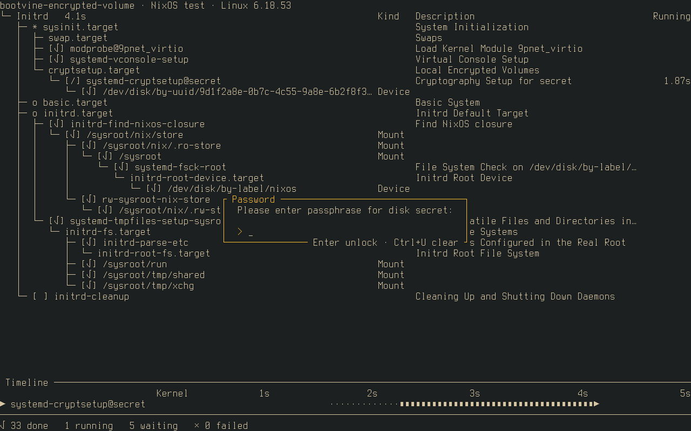
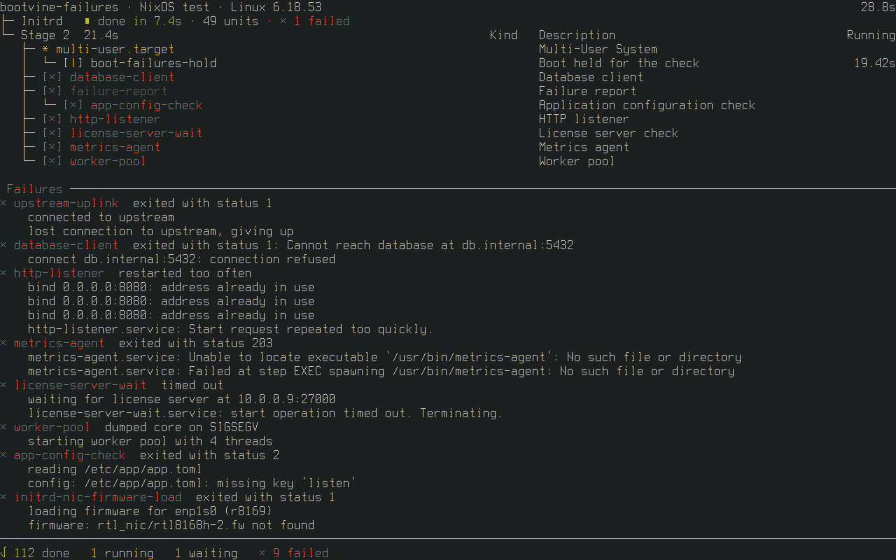

# Guide

What bootvine shows on the console, part by part, with the recordings that go
with each. The animations come from the [scripted demos](#scripted-demos); the
screenshots come from the [VM checks](development.md#testing) on real NixOS
machines.

## Reading the screen


From top to bottom:

1. **The header**: the host name, the system and its generation on NixOS
   (otherwise the `PRETTY_NAME` from `os-release`), and the kernel. Once a
   stage has finished, the total time since the kernel started sits on the
   right.
2. **The stages**: each finished stage, such as `Initrd`, with how long it
   took, how many units finished in it and how many of them failed. The stage
   still running is the last line, ending in `Running`.
3. **The tree** of units with a pending job. Each unit is nested under the unit
   waiting on it, and the milestone targets (`sysinit.target`, `basic.target`,
   `multi-user.target`, `graphical.target`) open the levels:
   - `◆` is the stage being worked on, `◇` one still to come, `√` one reached
     (`*`, `o` and `+` on console fonts without those glyphs);
   - `[|]` with a spinner is running, `[ ]` is waiting, `[√]` finished in the
     last couple of seconds (`keep-finished-units-for`);
   - `[×]` in bold red broke or timed out; dimmed red failed only because a
     unit it needed did;
   - the `Running` column counts up while a unit runs, and after 5 seconds the
     `Timeout` column shows the limit systemd will stop it at, red once it
     is passed;
   - a unit waiting on exactly one other, which waits on exactly one other,
     folds into one row joined by `─`; mounts and devices show their
     description instead of their unit name.

   When the tree is taller than the screen, finished and waiting rows give way
   first, and a last line counts the units left out.
4. **The failure panel**, only once a unit broke or timed out; see
   [failures](#failures).
5. **The timeline**, in the room left below the tree: the milestones reached,
   with how many units they took, the slowest finished units (up to five, and
   none shorter than `hide-runs-shorter-than`) and the units still running,
   as bars against seconds since the kernel started. A `│` marks the switch
   from the initrd to the real root.
6. **The footer**: the units done, running, waiting and failed so far.

## Booting through the initrd

The same recording shows a boot from the start. With a systemd initrd,
bootvine starts about a second after the kernel:

- **The initrd stage**: udev settling, the root device and its file systems
  under `initrd.target`.
- **The switch to the real root**: the initrd moves into the stages at the
  top, with its time and unit count, and the tree starts again under the
  default target. The timeline keeps the initrd's runs, left of the `│`.
- **Stage 2** up to `graphical.target`.
- **The handover**: bootvine hands the console back once the default target is
  reached, or earlier, once the display manager has switched to its own
  terminal.

How bootvine gets in that early and survives the switch is in
[architecture](architecture.md#starting-in-the-initrd).

## Shutdown


On a poweroff, reboot or halt the tree turns around:

- its root is the target being reached, such as `poweroff.target`;
- each unit being stopped sits under the units that have to stop before it,
  so the unit holding up the shutdown is at the bottom of its branch;
- `shutdown.target`, `umount.target` and `final.target` open the levels;
- the screen stays until systemd hands over to `systemd-shutdown`.

## Passphrase prompts



When a unit asks for a passphrase, such as `systemd-cryptsetup@….service`
unlocking a [LUKS](https://gitlab.com/cryptsetup/cryptsetup) volume, the
question floats over a dimmed tree:

- typing shows one mark per character;
- `Enter` sends it, and the popup says it is checking;
- a wrong passphrase brings the prompt back with "Wrong passphrase, try
  again";
- once unlocked, the popup closes and the boot carries on.

If another password agent, such as Plymouth's, was already asking when
bootvine started, bootvine waits behind it.

## Failures



A unit that broke or timed out gets an entry in the failure panel, newest
first:

- **The headline**: the unit and why it failed, such as `exited with status 2`,
  `killed by SIGSEGV`, `timed out`, `restarted too often` or
  `exited with status 203` (systemd could not run the command). A service that
  reported a status with `sd_notify` adds it, as in
  `exited with status 1: Cannot reach database`.
- **The journal lines**: up to six of the unit's last messages from this boot,
  the same ones `journalctl -u` shows, without systemd's own "Starting…" and
  "Failed with result…" lines.
- **Out of room**: the newest failure keeps its lines, older ones shrink to
  their headline, and a last line counts the rest.
- **What stays out**: a unit that failed only because one it needed did stays
  dimmed in the tree, so the panel points at the unit that actually broke.
  The footer counts both.

Failures from the initrd stay in the panel after the switch to the real root.
The screenshot comes from the `failures` sample machine, with every kind of
failure systemd reports.

## Trying it

Neither of these touches your system's boot.

### Scripted demos

Play a scripted boot, poweroff and passphrase prompt in your terminal, with
[Rust](https://www.rust-lang.org/tools/install) installed:

```sh
git clone https://codeberg.org/wvhulle/bootvine.git
cd bootvine
cargo run --bin scripted-boot
cargo run --bin scripted-shutdown
cargo run --bin scripted-luks-unlock
```

`q` quits. The encrypted root unlocks with the passphrase `demo`; `Esc` quits
while it asks. These are the scenarios the animations above were recorded
from.

### Sample machines

Each sample machine boots in a [QEMU](https://www.qemu.org) window with
[Nix](https://nixos.org/download/), and logs in as root at the end. `poweroff`
shows the shutdown.

| Run | Shows |
| --- | --- |
| `nix run .#sample-vm-slow-services` | slow units in the initrd and stage 2, one failing unit, and the handover to a greetd login |
| `nix run .#sample-vm-text-console` | the same units without a display manager, handing over at the default target |
| `nix run .#sample-vm-scripted-initrd` | the same units with NixOS's scripted initrd, so bootvine starts in stage 2 only |
| `nix run .#sample-vm-encrypted-volume` | a LUKS volume unlocked in the initrd; the passphrase is `sample passphrase` |
| `nix run .#sample-vm-failures` | a firmware failure in the initrd, then units that exit with an error, crash, time out, cannot be run, restart too often, report a status, die after starting, and one that fails only through its dependency |

Each machine keeps its disk in `~/.cache/bootvine-<machine>.qcow2`; delete it
to start fresh. The machines live in `vm-tests/`, one folder each, next to the
checks that drive them.
